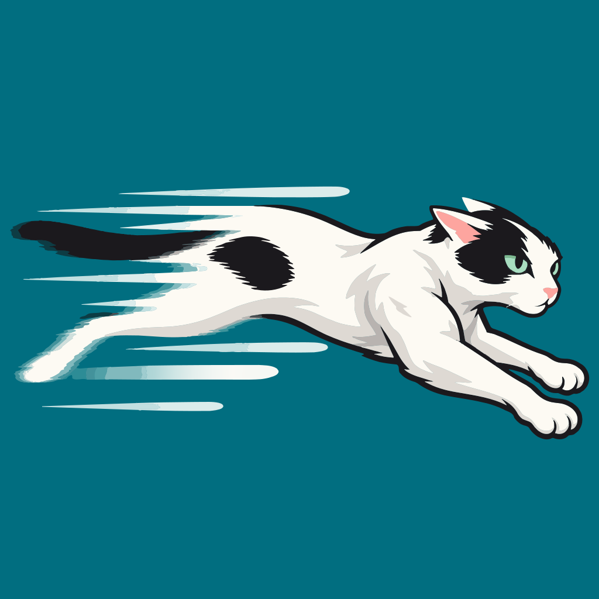

# Wind Run



A quiet running app for iPhone and Apple Watch. Tap start, run, and see where you went. Turn on pace call-outs in Settings to hear each split read aloud, every distance (¼ mi to 5 mi, or 250 m to 5 km) or every stretch of time (30 sec to 30 min). Coach plans and interval workouts are on the way, for anyone training between a 5K and a marathon. The iPhone app follows the iPhone's Light or Dark setting; Settings → Appearance can hold it on Light or Dark instead. The watch is always dark.

Privacy first: runs and routes are stored on the device with SwiftData. iCloud sync is off until the runner turns it on, and turning it off deletes the iCloud copy. There's no account and no analytics. The first time the iPhone app opens it asks for metric or imperial units. Units and call-outs pass directly between your paired iPhone and Apple Watch, and call-outs are spoken on the device. With iCloud sync on, every setting goes to iCloud with the runs too.

Apple Health is optional and off by default. The first time Wind Run opens on each device it asks, right after heart rate, whether to save runs to Health, and Save runs to Health in Settings changes it later. With it on, each finished run is added to Health as an outdoor running workout with its distance, pauses and route. Turning it off stops new runs from being saved; workouts already in Health stay there.

Heart rate is optional too, and off by default. The first time Wind Run opens on each device it asks whether to turn it on, and it can be changed later in Settings. With it on, each run starts a HealthKit workout session, which passes along live heart rate from an Apple Watch, AirPods Pro 3, Powerbeats Pro 2, or a Bluetooth strap paired in Settings. Readings are kept with the run in Wind Run's store. The run screens show the current heart rate, and the run detail charts heart rate over the whole run with its minimum, maximum, mean and variance. Heart rate is the only thing Wind Run reads from Health. The session's own workout is always discarded, so only Save runs to Health ever adds a run to Health. On the watch, the session also keeps the app running with the wrist down.

On iPhone, a run with heart rate on also shows a Live Activity on the Lock Screen and in the Dynamic Island: the current heart rate and a graph of the last five minutes. The app updates it on the device, with no push server, and it ends with the run. Runs recorded only on the watch don't get one yet.

## Project

- `WindRun.xcodeproj` with four targets:
  - `WindRun`: the iPhone app. It embeds the watch app and the Live Activity.
  - `WindRunWatch`: the Apple Watch app. It runs on its own with its own local store.
  - `WindRunLiveActivity`: the iPhone heart rate Live Activity. `LiveActivityShared/` holds what it and the app both compile.
  - `WindRunTests`: Swift Testing unit tests for the models.
- `Shared/` is compiled into both apps: SwiftData models, the GPS `RunRecorder`, pace call-outs, settings sync, formatting, the optional Apple Health sync (`HealthSync`), live heart rate (`HeartRateMonitor`), and first-open prompts (`Shared/Prompts/`: add a `Prompt` to `Prompt.all` when a feature needs the runner's go-ahead; each device asks it once).
- The iPhone app keeps recording and speaking with the phone locked (`audio` and `location` background modes in `WindRun/Info.plist`).
- If the system closes the app mid-run, the next launch finishes that run at its last GPS fix or heart rate reading (`RunRecovery`), so it shows in the list. A run that recorded nothing is deleted.
- Folders are file-system-synchronized, so new `.swift` files are picked up without editing the project file.
- `Branding/logo.svg` is the logo source. The app icons in both asset catalogs are 1024 px renders of it; the watch one is scaled to 86% so the paws and tail clear the round mask.
- SwiftUI and SwiftData only, no third-party dependencies. iOS 26 and watchOS 26. Code is main-actor isolated by default.

## Models

| Model | What it is |
| --- | --- |
| `Run` | One recorded run: kind (run, intervals, coach), status, distance, pauses, route, heart rate. |
| `RouteSample` | One GPS fix: time, position, altitude, accuracy, speed, course. |
| `RunPause` | A stretch where the clock was paused. |
| `HeartRateSample` | One heart rate reading, taken while the run was active. |
| `IntervalPlan` → `IntervalBlock` → `IntervalStep` | A saved interval workout. A block repeats its steps, so "10 min warm up, 5 × (3 min hard, 2 min easy), 10 min cool down" is three blocks. `timeline` writes out every step in order. |
| `CoachPlan` → `CoachWeek` → `CoachWorkout` | A coach plan toward a goal: build distance, speed work, or an event on a date. |

Conventions follow PowerJack: stored properties end in `Value` and are read through accessors, ordered children carry an `order` and are returned sorted, and state changes go through guarded methods that log instead of throwing.

iCloud sync puts two more rules on every model: to-many relationships are optional (`[RouteSample]? = []`), and every relationship has an inverse. `SyncReadinessTests` fails if a model breaks either.

## iCloud sync

Settings → Your Data → iCloud Sync. It's off by default and needs the iPhone to be signed in to iCloud.

- `WindRunStore` (`WindRun/Persistence/`) owns the model container. Turning sync on or off swaps in a new container on the same store file, and the root view rebuilds its screens from it.
- Data goes to the runner's private CloudKit database in `iCloud.com.stanleycloud.WindRun`, in the zone SwiftData mirrors into.
- Turning sync off asks first, closes the syncing container, then deletes that zone. If iCloud can't be reached, nothing is deleted and sync stays on. If the iPhone is signed out, the runner can turn sync off and leave the copy in iCloud.
- Settings sync too, through iCloud's key-value store (`CloudSettings`), only while iCloud Sync is on. Every key in `CloudSettings.keys` is copied under a `settings.` prefix. Turning sync on takes what's already in iCloud, so a new iPhone gets the old one's settings, and sends up anything iCloud doesn't have. After that each change goes both ways. Turning sync off deletes them with the runs. Which first-open prompts were answered and the iCloud Sync switch itself stay on each device. A new setting stored in `UserDefaults` must be added to `CloudSettings.keys`.
- The watch keeps its own local store and doesn't sync. It gets units and call-outs from the iPhone.

Trying it in the simulator, where nobody is signed in to iCloud: run with `-fakeICloud signedIn`, `-fakeICloud signedOut` or `-fakeICloud unreachable` (debug builds only; both are in the `WindRun` scheme, turned off).

Before a TestFlight or App Store build, after any model change: run from Xcode with `-initCloudKitSchema` while signed in to iCloud, then deploy the Development schema to Production in the CloudKit Console.

## Build and test

```bash
# iPhone app (builds the watch app too)
xcodebuild -project WindRun.xcodeproj -scheme WindRun \
  -destination 'platform=iOS Simulator,name=iPhone 18 Pro' build

# Watch app on its own
xcodebuild -project WindRun.xcodeproj -scheme WindRunWatch \
  -destination 'generic/platform=watchOS Simulator' build

# Unit tests
xcodebuild -project WindRun.xcodeproj -scheme WindRun \
  -destination 'platform=iOS Simulator,name=iPhone 18 Pro' test
```

To try a run in the simulator, feed it a route: `xcrun simctl location booted start --speed=3.5 37.7749,-122.4194 37.7800,-122.4194`.

## Releasing

Three long-lived branches, each feeding the next through a pull request:

| Branch | Takes pull requests from | On merge |
| --- | --- | --- |
| `main` | feature branches | CI builds and tests |
| `staging` | `main` only | a signed build goes to TestFlight and the beta groups |
| `prod` | `staging` only | a signed build goes to App Store Connect and is submitted for review |

- **CI** (`.github/workflows/ci.yml`) runs the unit tests on an iPhone simulator and builds the watch app, on every pull request into the three branches. Its check is called `Build and test`.
- **Promotion guard** (`promotion-guard.yml`) fails any pull request into `staging` that isn't from `main`, and into `prod` that isn't from `staging`. Its check is called `Source branch`.
- **TestFlight** (`testflight.yml`) and **App Store** (`app-store.yml`) run `fastlane ios beta` and `fastlane ios release` through `release-build.yml`. Each build gets the next build number after the latest one in App Store Connect, and its `.ipa` and dSYMs are kept as a workflow artifact for 90 days. Both can be re-run from the Actions tab (Run workflow, on their own branch).
- The rulesets in `.github/rulesets/` hold the merge rules: a pull request, both checks passing, merge commits only (so the three branches never drift apart), no force pushes or deletion. Import each one in Settings → Rules → Rulesets → New ruleset → Import a ruleset.

The release lanes sign with an Apple Distribution certificate and fetch an App Store profile for each target, so the project keeps automatic signing for day-to-day work. They need these secrets, in the `testflight` and `app-store` environments or on the repository:

| Secret | What it is |
| --- | --- |
| `ASC_KEY_ID` | Key ID of an App Store Connect team API key with the Admin role (Users and Access → Integrations) |
| `ASC_ISSUER_ID` | The issuer ID shown above that key list |
| `ASC_KEY_P8_BASE64` | The key's `.p8` file, base64: `base64 -i AuthKey_XXXX.p8 \| pbcopy` |
| `DIST_CERT_P12_BASE64` | An Apple Distribution certificate with its private key, exported from Keychain Access as `.p12`, base64 |
| `DIST_CERT_PASSWORD` | The password set on that `.p12` |

And these repository variables:

| Variable | What it is |
| --- | --- |
| `TESTFLIGHT_GROUPS` | The beta group's name in TestFlight (comma-separated for more than one). Required. |
| `TESTFLIGHT_EXTERNAL` | `true` if that group is an external group. External builds go through Beta App Review; the first one waits for it, later ones usually pass on their own. |
| `APP_STORE_AUTOMATIC_RELEASE` | `false` to hold an approved version until it's released by hand. Releases on approval otherwise. |

Before merging into `prod`:

- Raise `MARKETING_VERSION` (in every target) on `main` once a version has gone out. App Store Connect won't take a new build for a version that's already live.
- Fill in the version's App Store details in App Store Connect: screenshots, description and privacy details the first time, and What's New for each update. The lane uploads the binary and submits; it doesn't write the listing.
- After a model change, deploy the CloudKit schema to Production (see iCloud sync above). TestFlight and App Store builds use the Production environment.
